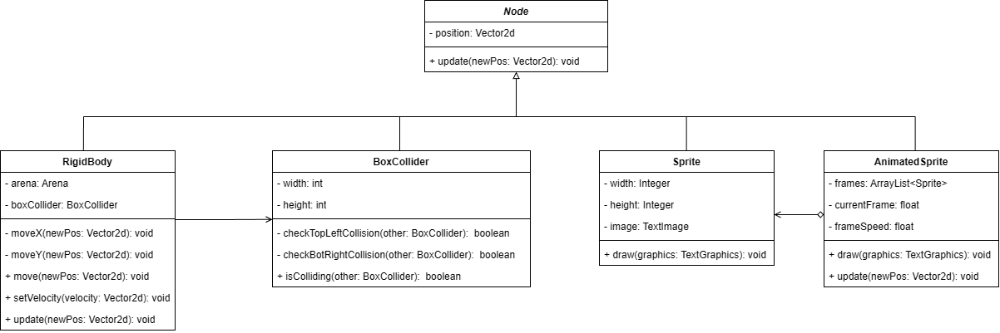
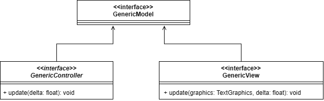
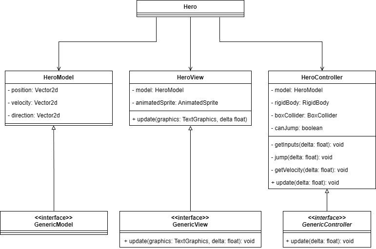
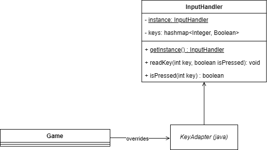

## LDTS_t02g04 - <Celeste Pico 8>

O projeto pretende recriar o jogo de plataforma Celeste na versão feita no Pico 8 (uma engine de jogos 8 bits).
O objetivo do jogo é controlar Madeline (personagem principal) a escalar a montanha Celeste enquanto coleta morangos. O personagem consegue andar, pular e dar *dashes* para ultrapassar obstáculos e chegar no pico da montanha. 

Este projeto foi desenvolvido pelo ..., Gustavo Pereira da Cunha Bastos (up202403874@up.pt) e pelo *Tiago Su* (up202403468@up.pt) para a cadeira LDTS 2025/2026

### IMPLEMENTED FEATURES

- **Player Controller** - O *user* consegue mover o personagem utilizando as setas do teclado e pular com a seta para cima
- **Gravidade** - O *player* é afetado por uma gravidade básica
- **Animações** - O personagem tem um sprite animado.
- **Colisões** - O personagem consegue colidir com objetos, assim, impedindo de ter *overlaps* entre objetos.

### PLANNED FEATURES

- **Tiles** - Planejamos criar *tiles* para serem paredes e o chão
- **Morangos** - Planejamos adicionar os colecionaveis/moedas do jogo
- **Levels** - Planejamos recriar alguns *levels* do jogo original
- **Dash** - Planejamos adicionar o dash clássico do personagem
- **Better movement** - Planejamos melhor o movimento do personagem como melhorar a física e adicionar algumas funcionalidades para facilitar na jogabilidade como *inputs buffers*
- **Machine state** - Máquina de estados para representar o estado do *player* e do jogo

 //Input buffer
 //UML machine state do player
 //Dash
 //Morangos

### DESIGN

#### Como criar objetos que tenham uma imagem e física de forma eficiente

**Problem in Context**

Um jogo é composto por muitos objetos com funcionalidades semelhantes como desenhar uma imagem ou checar colisões e entre outros. Dessa forma, o problema em questão é como podemos implementar essas funcionalidades específicas de forma eficiente e de modo a evitar repetir implementações desnecessárias.

**The Pattern**

Para resolver isso, decidimos usar como referência componentes das engines como Unity e Godot, ou seja, utilizamos o *Composite Pattern*, de modo, a criar componentes básicos capazes de executar uma única funcionalidade, e devem ser independentes do objeto que os contêm.
Assim, qualquer objeto é composto por esses componentes, facilitando a implementação de vários objetos com comportamentos parecidos e evitando repetir o mesmo código.

**Implementation**

Para implementar, criamos uma classe abstrata Node em que contêm, por enquanto, uma posição e um método *update* de posições. E a partir dessa classe, todos componentes vão extender dela.
As funcionalidades necessárias são:
- Sprite e AnimatedSprite: um componente capaz de desenhar uma imagem ou animação
- BoxCollider: um componente que representa um *collider*
- RigidBody: um componente responsável por calcular a próxima posição válida dada uma velocidade

As classes relacionadas com o tópico podem ser achadas nos seguintes ficheiros:

- [Sprite](src/main/java/com/aor/components/Sprite.java)
- [AnimatedSprite](src/main/java/com/aor/components/AnimatedSprite.java)
- [BoxCollider](src/main/java/com/aor/components/BoxCollider.java)
- [RigidBody](src/main/java/com/aor/components/RigidBody.java)

**Consequences**

O uso dessa estratégia teve os seguintes benefícios:
- Uma vez implementado a classe não será necessária preocupar-se com implementar de novo
- Facilidade em criar objetos como, por exemplo, a classe Hero em que é composto por um RigidBody, AnimatedSprite e BoxCollider
- O *design* de blackbox ajuda em não se preocupar com detalhes particulares do funcionamento

------

#### Como estruturar o projeto

**Problem in Context**

Um grande problema no projeto, é como organizamos de forma estruturada as nossas classes, de forma, a evitar incongruencia de dados e melhor a capacidade de manutenção do código.

**The Pattern**

Para organizar, o código decidimos estruturar o projeto seguindo os principios do modelo MVC.
Esse modelo possibilita ter centralização de dados do objeto ao ter uma única classe para armazenar e na separação da parte visual e lógica ao ter um view e um controller, respetivamente.

**Implementation**

Para implementar cada classe do MVC, decidimos as seguintes criar classes abstratas:
- GenericModel: uma classe que armazena apenas a sua posição, velocidades e direção
- GenericView: uma classe com um Sprite ou AnimatedSprite
- GenericController: uma classe com um BoxCollider e RigidBody

E com essa estrutura, a criação do Hero tornou-se assim:

As classes relacionadas com o tópico podem ser achadas nos seguintes ficheiros:

- [GenericModel](src/main/java/com/aor/mvc/GenericModel.java)
- [GenericView](src/main/java/com/aor/mvc/GenericView.java)
- [GenericController](src/main/java/com/aor/mvc/GenericController.java)
- [Hero](src/main/java/com/aor/hero/Hero.java)
- [HeroModel](src/main/java/com/aor/hero/HeroModel.java)
- [HeroView](src/main/java/com/aor/hero/HeroView.java)
- [HeroController](src/main/java/com/aor/hero/HeroController.java)

**Consequences**

O uso dessa estratégia teve os seguintes benefícios:
- Boa organização de um objeto complexo
- Maior facilidade em controlar as variáveis do objeto

------

#### Como os objetos captar *inputs*

**Problem in Context**

Durante o jogo, muitos objetos precisam captar e ler diversos *inputs*. E o problema é como captamos, guardamos e enviamos essa informação para o projeto todo:

**The Pattern**

Este problema foi resolvido usando dois *design patterns* que são Singleton e Observers. O uso de Singleton vai permitir centralizar a leitura dos *inputs* numa só instância e evitar a passagem por argumentos de valores entre objetos.
E para impedir que existem paragens para leitura *inputs*, decidimos utilizar observers que vão enviar um sinal quando existe um input feito pelo player.

**Implementation**

No projeto, criamos uma classe chamada InputHandler em que tem armazenado um hashmap com os pares <KeyType, Boolean> que representam o *input* e se foi pressionado.
A leitura de inputs foi implementada ao utilizar os eventsListeners do Java (KeyListerner) em que demos *overwrite* nas funções keyPressed e keyRealeased em que ambas envião um sinal para o Singleton atualizar o hashmap.
Por fim, para qualquer objeto que necessite de ler um input, só precisa chamar a função isPressed para verificar se a tecla foi pressionada.

As classes relacionadas com o tópico podem ser achadas nos seguintes ficheiros:

- [InputHandler](src/main/java/com/aor/game/InputHandler.java)

**Consequences**

O uso dessa estratégia teve os seguintes benefícios:
- Facilidade em ler inputs, armazená-los e utilizá-los
- Não é preciso ser preocupar em enviar os *inputs* de objeto para objeto
- Informação centralizada

Com o uso de Singleton, existe um grande problema no contexto de testar código.

------

#### KNOWN CODE SMELLS

1º code Smell: 
- Todos os componentes são subclasses 

### TESTING

- Screenshot of coverage report.
- Link to mutation testing report.

### SELF-EVALUATION

> In this section describe how the work regarding the project was divided between the students. In the event that members of the group do not agree on a work distribution, the group should send an email to the teacher explaining the disagreement.

**Example**:

- Gustavo Pereira da Cunha Bastos: 33%
- ....: 33%
- Tiago Su: 33%