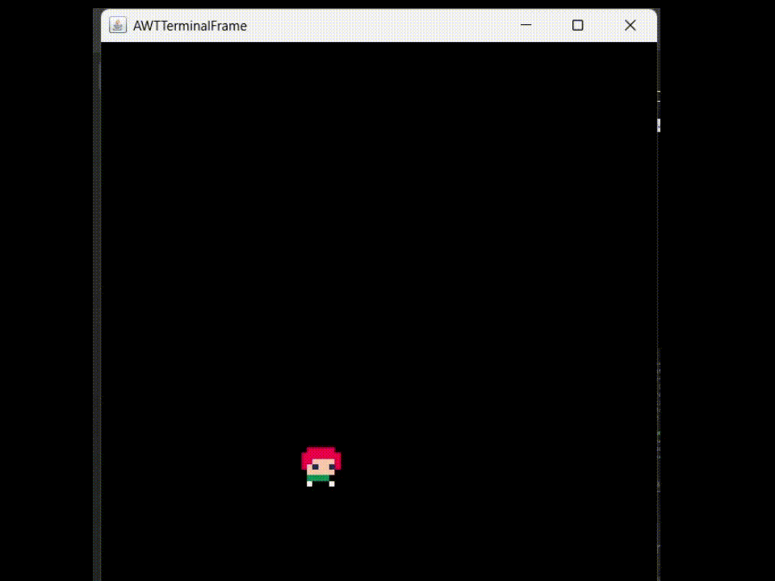
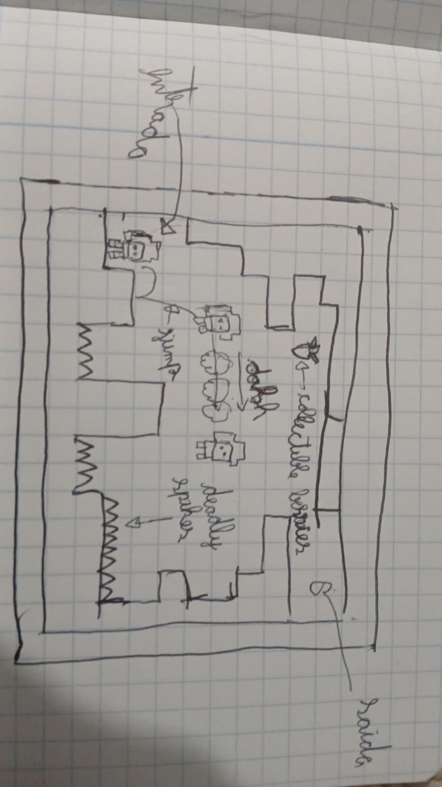
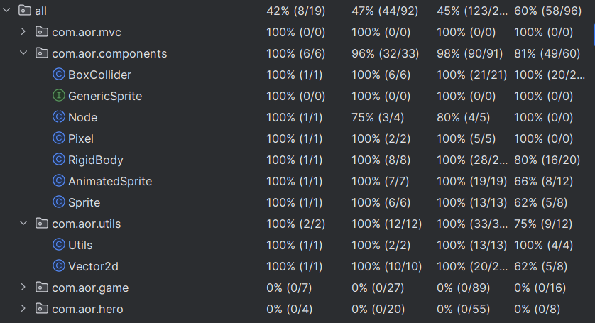

## LDTS_t02g04 - <Celeste Pico 8>

O projeto pretende recriar o jogo de plataforma Celeste na versão feita no Pico 8 (uma engine de jogos 8 bits).
O objetivo do jogo é controlar Madeline (personagem principal) a escalar a montanha Celeste enquanto coleta morangos. O personagem consegue andar, pular e dar *dashes* para ultrapassar obstáculos e chegar no pico da montanha. 

Este projeto foi desenvolvido pelo Pedro Manuel Cerqueira Gonçalves (up202305057@up.pt), Gustavo Pereira da Cunha Bastos (up202403874@up.pt) e pelo *Tiago Su* (up202403468@up.pt) para a cadeira LDTS 2025/2026

### IMPLEMENTED FEATURES

- **Player Controller** - O *user* consegue mover o personagem utilizando as setas do teclado e pular com a seta para cima;
- **Gravidade** - O *player* é afetado por uma gravidade básica;
- **Animações** - O personagem tem um *sprite* animado;
- **Colisões** - O personagem consegue colidir com objetos, assim, impedindo de ter *overlaps* entre objetos.

### GIF demonstrando a física básica

  

  <b><i>Fig. 1 Demonstração da gravidade e do pulo</i></b>

### PLANNED FEATURES

- **Tiles** - Planeamos criar *tiles* para serem paredes e o chão;
- **Morangos** - Planeamos adicionar os colecionáveis/moedas do jogo;
- **Levels** - Planeamos recriar alguns *levels* do jogo original;
- **Dash** - Planeamos adicionar o dash clássico do personagem;
- **Better movement** - Planeamos melhorar o movimento do personagem e a física do jogo;
- **Machine state** - Máquina de estados para representar o estado do *player* e do jogo.

### Mockup do estado proposto final do projeto

  

  <b><i>Fig. 2 Estado final do jogo</i></b>

### DESIGN

#### Como criar objetos que tenham uma imagem e física de forma eficiente

**Problem in Context**

Um jogo é composto por muitos objetos com funcionalidades semelhantes, como desenhar uma imagem ou checar colisões e entre outros. Dessa forma, o problema em questão é como podemos implementar essas funcionalidades específicas, de forma eficiente e de modo a evitar repetir implementações desnecessárias.

**The Pattern**

Para resolver isso, decidimos usar como referência componentes das engines como Unity e Godot, ou seja, utilizamos o *Composite Pattern*, de modo, a criar componentes básicos capazes de executar uma única funcionalidade, e devem ser independentes do objeto que os contêm.
Assim, qualquer objeto é composto por esses componentes, facilitando a implementação de vários objetos com comportamentos parecidos e evitando repetir o mesmo código.
Este *design* tem como ideia de promover ao máximo o *Single Responsibility Principle*.

**Implementation**

Para implementar, criamos uma classe abstrata *Node* que contêm, por enquanto, uma posição e um método *update* para atualizar a sua posição. E a partir dessa classe será criada subclasses que serão os componentes.
Os componentes necessários são:
- Sprite e AnimatedSprite: um componente capaz de desenhar uma imagem ou animação, respetivamente
- BoxCollider: um componente que representa um *collider*
- RigidBody: um componente responsável por calcular a próxima posição válida dada uma velocidade

  

  <b><i>Fig. 3 UML dos componentes</i></b>

As classes relacionadas com o tópico podem ser achadas nos seguintes ficheiros:

- [Node](src/main/java/com/aor/components/Node.java)
- [Sprite](src/main/java/com/aor/components/Sprite.java)
- [AnimatedSprite](src/main/java/com/aor/components/AnimatedSprite.java)
- [BoxCollider](src/main/java/com/aor/components/BoxCollider.java)
- [RigidBody](src/main/java/com/aor/components/RigidBody.java)

**Consequences**

O uso dessa estratégia teve os seguintes benefícios:
- Uma vez implementado a funcionalidade não será necessária preocupar-se com a implementação de novo;
- Facilidade em criar objetos como, por exemplo, a classe Hero em que é composto por um RigidBody, AnimatedSprite e BoxCollider;
- O *design* de blackbox ajuda em não se preocupar com detalhes particulares do funcionamento;
- Boa organização respeitando o *Single Responsibility Principle*.

------

#### Como estruturar o projeto

**Problem in Context**

Um grande problema no projeto, é como organizamos de forma estruturada as nossas classes, de forma, a evitar incongruências nos dados e melhor a capacidade de manutenção do código.

**The Pattern**

Para organizar, o código decidimos estruturar o projeto seguindo os princípios do modelo MVC.
Esse modelo possibilita ter centralização de dados do objeto, ao ter uma classe única para armazenar dados, e na separação da parte visual e lógica ao ter um view e um controller, respetivamente.

**Implementation**

Para implementar cada classe do MVC, decidimos criar as seguintes interfaces:
- GenericModel
- GenericView
- GenericController

  

  <b><i>Fig. 4 UML do MVC</i></b>

E com essa estrutura, a criação do *Hero* ficou assim:

  

  <b><i>Fig. 5 MVC aplicado no Hero</i></b>

As classes relacionadas com o tópico podem ser achadas nos seguintes ficheiros:

- [GenericModel](src/main/java/com/aor/mvc/GenericModel.java)
- [GenericView](src/main/java/com/aor/mvc/GenericView.java)
- [GenericController](src/main/java/com/aor/mvc/GenericController.java)
- [Hero](src/main/java/com/aor/hero/Hero.java)
- [HeroModel](src/main/java/com/aor/hero/HeroModel.java)
- [HeroView](src/main/java/com/aor/hero/HeroView.java)
- [HeroController](src/main/java/com/aor/hero/HeroController.java)

**Consequences**

O uso dessa estratégia teve os seguintes benefícios:
- Boa organização de um objeto complexo;
- Maior facilidade em controlar as variáveis do objeto;
- Utilização do *Single Responsibility Principle*.

------

#### Como os objetos captar *inputs*

**Problem in Context**

Durante o jogo, muitos objetos precisam captar e ler diversos *inputs*. E o problema é como captamos, guardamos e enviamos essa informação para o projeto todo:

**The Pattern**

Este problema foi resolvido usando dois *design patterns* que são Singleton e Observers. O uso de Singleton vai permitir centralizar os dados dos *inputs* numa só instância e evitar a passagem por argumentos de valores entre objetos.
E para ler os *inputs*, decidimos utilizar observers que vão enviar um sinal quando existe um *input* feito pelo *player*.

**Implementation**

No projeto, criamos uma classe chamada InputHandler em que tem armazenado um hashmap com os pares <Integer, Boolean>, que representam o *input* e se a tecla foi pressionado.
A leitura de *inputs* foi implementada ao utilizar os eventsListeners do Java (KeyListerner), em que fizemos *override* nas funções *keyPressed* e *keyRealeased* em que ambas envião um sinal para o Singleton atualizar o hashmap.
Por fim, para qualquer objeto que necessite de ler um *input*, só precisa chamar a função isPressed para verificar se a tecla foi pressionada.

  

  <b><i>Fig. 6 UML do Inputhandler</i></b>

As classes relacionadas com o tópico podem ser achadas nos seguintes ficheiros:

- [InputHandler](src/main/java/com/aor/game/InputHandler.java)

**Consequences**

O uso dessa estratégia teve os seguintes benefícios:
- Facilidade em ler inputs, armazená-los e utilizá-los;
- Não é preciso ser preocupar em enviar os *inputs* de objeto para objeto;
- Informação centralizada.

Com o uso de Singleton, existe um grande problema no contexto de testar código.

------

#### KNOWN CODE SMELLS

Todos os objetos complexos dependem dos componentes que são subclasses do Node, por isso qualquer alteração na classe Node pode causar muitos problemas 

### TESTING

Só foi testado as classes nas package *components* e *utils*.

  

  <b><i>Fig. 7 Test Coverage</i></b>

Link para o relatório do *pitest*:
[Mutation Test](misc/pitestReport1/index.html)

### SELF-EVALUATION

- Gustavo Pereira da Cunha Bastos: 33.3%
- Pedro Manuel Cerqueira Gonçalves: 33.3%
- Tiago Su: 33.3%